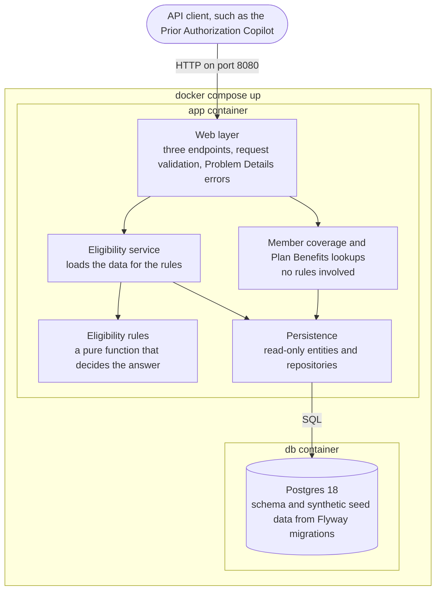

# Eligibility & Benefits Service

[](https://github.com/jconley-scales/eligibility-benefits-service/actions/workflows/ci.yml?query=branch%3Amain)

A small Java REST service that answers an Eligibility check for one Member, one Procedure, and one Service date. It is the eligibility backend for the Prior Authorization Copilot, a separate project, and it runs on synthetic data only.

**[API docs](https://jconley-scales.github.io/eligibility-benefits-service/)** · **[Glossary](GLOSSARY.md)** · **[Design decisions](#design-decisions)**

## What it does

An Eligibility check answers four questions about one Member, one Procedure, and one Service date:

1. **Is the Member's coverage active** on the Service date? Every answer is judged as of the Service date, past or future, never as of today.
2. **What is the Plan's Benefit** for the procedure: covered, not covered, or no benefit on file?
3. **Is prior authorization required** for the procedure under the Member's Plan?
4. **What is the Member's cost share:** the copay, the coinsurance, and whether the deductible applies? The answer also gives how much of the deductible and out-of-pocket maximum remains in the plan year.

| Endpoint                              | Returns                                                  |
| ------------------------------------- | -------------------------------------------------------- |
| `POST /v1/eligibility/check`          | The answer to an Eligibility check                       |
| `GET /v1/members/{memberId}/coverage` | A Member's Coverages, each with its Plan, by start date  |
| `GET /v1/plans/{planId}/benefits`     | A Plan's details and its Benefits                        |

The Copilot sends anything other than active coverage with a `COVERED` Benefit to a human reviewer, and `priorAuthRequired` decides whether its prior authorization workflow runs at all.

**All data is synthetic.** Every Plan, Member, Coverage, Benefit, and Accumulator is invented and loaded by the repo's own migrations. There is no protected health information (PHI) anywhere in this repo, and the database rejects any Member that isn't marked synthetic.

## Architecture



- **Web layer** ([`web`](src/main/java/io/github/jconleyscales/eligibility/web)): the three endpoints, request validation, and every error as RFC 9457 Problem Details. springdoc-openapi generates the API contract from it.
- **Eligibility service** ([`EligibilityService`](src/main/java/io/github/jconleyscales/eligibility/service/EligibilityService.java)): loads the Member, the Coverage active on the Service date, its Plan, the Plan's Benefit for the procedure, and the Accumulator for the plan year, then hands them to the rules. Apart from rejecting an unknown Member, it decides nothing itself. The Member coverage and Plan Benefits lookups return what they load, with no rules involved.
- **Eligibility rules** ([`EligibilityRules`](src/main/java/io/github/jconleyscales/eligibility/rules/EligibilityRules.java)): a pure function with no I/O and no framework that turns the loaded data into the answer. It decides the plan year, the Benefit status, which terms come back, the remaining amounts (never below zero), and money to two decimals. It's the file to read first.
- **Persistence** ([`persistence`](src/main/java/io/github/jconleyscales/eligibility/persistence)): read-only JPA entities and repositories. Finding the Coverage active on a Service date is one query, in which the end date is a covered day and no end date means ongoing.
- **Postgres 18:** Flyway owns the schema and loads the seed data at startup. Hibernate then checks the schema against the entities, and the service refuses to start if they disagree. The database itself enforces one Coverage per Member at a time ([ADR 0002](docs/adr/0002-postgres-with-database-enforced-coverage-rule.md)).

`docker compose up` runs two containers. `db` runs the `postgres:18` image. `app` runs the service, built by the [`Dockerfile`](Dockerfile): it compiles on a JDK image and runs on a JRE image as a non-root user. Compose starts `app` once Postgres reports healthy, and publishes it on port 8080.

Built with Java 25, Spring Boot 4.1 (Spring MVC, Spring Data JPA, Bean Validation, Actuator), Postgres 18, Flyway, springdoc-openapi, and Testcontainers.

## How to run it

### Run the service

You need Docker and nothing else: no JDK and no cloud account.

```sh
docker compose up
```

The first run builds the image, which takes a few minutes. After changing the code, run `docker compose up --build` so the image is rebuilt. The service is ready when the health endpoint reports `UP`:

```sh
curl http://localhost:8080/actuator/health
```

```json
{"groups":["liveness","readiness"],"status":"UP"}
```

Stop it with `docker compose down`.

The service reads every connection setting from an environment variable with a local default, so the same image could run elsewhere unchanged: `DB_HOST`, `DB_PORT`, `DB_NAME`, `DB_USERNAME`, `DB_PASSWORD`, and `SERVER_PORT` (see [`application.yaml`](src/main/resources/application.yaml)). Under compose, which wires up the database host and port itself, you can set `DB_NAME`, `DB_USERNAME`, and `DB_PASSWORD` in the environment or a `.env` file. The defaults are local-only credentials for the synthetic database, not secrets.

To run the service from source instead, with JDK 25 and Docker, `./mvnw spring-boot:test-run` starts it on port 8080 against a throwaway Postgres container.

### Run the tests

The tests need JDK 25 and a running Docker, because they start a real Postgres 18 in a container through Testcontainers.

```sh
./mvnw verify
```

They test at three seams:

- **The HTTP API**, against the full application and real Postgres loaded by the same migrations as production: one test per seed edge case, plus the 400s, the 404s, the Problem Details format, and the API contract.
- **The Eligibility rules**, as plain unit tests with no Spring and no database.
- **The database**, inserting rows directly to prove the rules the read-only API can't: overlapping Coverages and non-synthetic Members are rejected, and back-to-back Coverages are accepted.

Every test uses an explicit Service date, never today, so no test breaks as the calendar moves. CI runs the same `verify` on every push and pull request, and also checks that `docker compose up` comes up healthy.

### Regenerate the API contract

springdoc-openapi generates the contract from the code, and `ApiContractTest` fails when the committed file, [`docs/api/openapi.json`](docs/api/openapi.json), differs from it. After an intended API change, regenerate the file and commit it with the change:

```sh
./mvnw test -Dtest=ApiContractTest -DregenerateContract
```

The diff of `docs/api/openapi.json` is the API change as clients will see it, so review it before committing. Once the change is on `main`, the docs page republishes.

## Example requests

Each example works as written against `docker compose up`, in a POSIX shell such as bash, zsh, or Git Bash. Each one uses an explicit Service date and a Member or Plan from the [synthetic seed data](#synthetic-seed-data), so the answers stay the same as the calendar moves. Responses are shown formatted; the service returns compact JSON.

### Eligibility check

`SYN-0001` asks about a knee arthroscopy (`29881`) on 2026-03-15:

```sh
curl -X POST http://localhost:8080/v1/eligibility/check \
  -H 'Content-Type: application/json' \
  -d '{"memberId": "SYN-0001", "procedureCode": "29881", "serviceDate": "2026-03-15"}'
```

```json
{
  "memberId": "SYN-0001",
  "procedureCode": "29881",
  "serviceDate": "2026-03-15",
  "coverage": {
    "active": true,
    "planId": "PPO-LOW-DED",
    "planName": "Synthetic Low-Deductible PPO",
    "planType": "PPO",
    "planYear": 2026,
    "deductibleRemaining": 312.50,
    "outOfPocketRemaining": 2587.25
  },
  "benefit": {
    "status": "COVERED",
    "priorAuthRequired": true,
    "deductibleApplies": true,
    "copay": 0.00,
    "coinsurancePercent": 20
  }
}
```

Coverage is active, and the Member has met $187.50 of the Plan's $500.00 deductible in 2026, so $312.50 remains. The Plan pays for the procedure with 20% coinsurance after the deductible, and prior authorization is required.

`SYN-0004`'s Coverage ended on 2025-12-31, so on the same date coverage isn't active. Every Coverage field but `active` is null, and there is no Benefit, because the Member can't use one:

```sh
curl -X POST http://localhost:8080/v1/eligibility/check \
  -H 'Content-Type: application/json' \
  -d '{"memberId": "SYN-0004", "procedureCode": "29881", "serviceDate": "2026-03-15"}'
```

```json
{
  "memberId": "SYN-0004",
  "procedureCode": "29881",
  "serviceDate": "2026-03-15",
  "coverage": {
    "active": false,
    "planId": null,
    "planName": null,
    "planType": null,
    "planYear": null,
    "deductibleRemaining": null,
    "outOfPocketRemaining": null
  },
  "benefit": null
}
```

#### Not covered is not the same as no benefit on file

`SYN-0009`'s Plan has a Benefit saying it doesn't pay for a sleep study (`95810`). That is the Plan's own answer:

```sh
curl -X POST http://localhost:8080/v1/eligibility/check \
  -H 'Content-Type: application/json' \
  -d '{"memberId": "SYN-0009", "procedureCode": "95810", "serviceDate": "2026-03-15"}'
```

```json
{
  "memberId": "SYN-0009",
  "procedureCode": "95810",
  "serviceDate": "2026-03-15",
  "coverage": {
    "active": true,
    "planId": "HMO-STANDARD",
    "planName": "Synthetic Standard HMO",
    "planType": "HMO",
    "planYear": 2026,
    "deductibleRemaining": 250.00,
    "outOfPocketRemaining": 4000.00
  },
  "benefit": {
    "status": "NOT_COVERED",
    "priorAuthRequired": null,
    "deductibleApplies": null,
    "copay": null,
    "coinsurancePercent": null
  }
}
```

`SYN-0010`'s Plan has no Benefit at all for physical therapy (`97110`). The answer is unknown, not unpaid, so it comes back as an answer with 200, and a person decides ([ADR 0003](docs/adr/0003-no-benefit-on-file-is-not-a-denial.md)):

```sh
curl -X POST http://localhost:8080/v1/eligibility/check \
  -H 'Content-Type: application/json' \
  -d '{"memberId": "SYN-0010", "procedureCode": "97110", "serviceDate": "2026-03-15"}'
```

```json
{
  "memberId": "SYN-0010",
  "procedureCode": "97110",
  "serviceDate": "2026-03-15",
  "coverage": {
    "active": true,
    "planId": "PPO-HIGH-DED",
    "planName": "Synthetic High-Deductible PPO",
    "planType": "PPO",
    "planYear": 2026,
    "deductibleRemaining": 3000.00,
    "outOfPocketRemaining": 7000.00
  },
  "benefit": {
    "status": "NO_BENEFIT_ON_FILE",
    "priorAuthRequired": null,
    "deductibleApplies": null,
    "copay": null,
    "coinsurancePercent": null
  }
}
```

#### Errors

Every error is RFC 9457 Problem Details, with `Content-Type: application/problem+json`. A malformed procedure code is rejected with 400 rather than answered as no benefit on file, so a typo never looks like a missing Benefit:

```sh
curl -X POST http://localhost:8080/v1/eligibility/check \
  -H 'Content-Type: application/json' \
  -d '{"memberId": "SYN-0001", "procedureCode": "7214", "serviceDate": "2026-03-15"}'
```

```json
{
  "detail": "procedureCode must be a CPT code (five digits), a CPT Category II or III code (four digits then F, T, or U), or a HCPCS Level II code (an upper-case letter then four digits).",
  "instance": "/v1/eligibility/check",
  "status": 400,
  "title": "Bad Request"
}
```

An unknown Member is a 404, which is different from coverage that isn't active:

```sh
curl -X POST http://localhost:8080/v1/eligibility/check \
  -H 'Content-Type: application/json' \
  -d '{"memberId": "SYN-9999", "procedureCode": "29881", "serviceDate": "2026-03-15"}'
```

```json
{
  "detail": "No member with ID SYN-9999.",
  "instance": "/v1/eligibility/check",
  "status": 404,
  "title": "Not Found"
}
```

### Member coverage

`SYN-0007` switched Plans mid-year. Each Coverage's end date is its last covered day, and a null end date means ongoing:

```sh
curl http://localhost:8080/v1/members/SYN-0007/coverage
```

```json
{
  "memberId": "SYN-0007",
  "coverages": [
    {
      "planId": "PPO-HIGH-DED",
      "planName": "Synthetic High-Deductible PPO",
      "planType": "PPO",
      "startDate": "2026-01-01",
      "endDate": "2026-06-30"
    },
    {
      "planId": "HMO-STANDARD",
      "planName": "Synthetic Standard HMO",
      "planType": "HMO",
      "startDate": "2026-07-01",
      "endDate": null
    }
  ]
}
```

### Plan Benefits

A Plan's details and its Benefits, ordered by procedure code. A Benefit with `covered` false has no terms:

```sh
curl http://localhost:8080/v1/plans/HMO-STANDARD/benefits
```

```json
{
  "planId": "HMO-STANDARD",
  "planName": "Synthetic Standard HMO",
  "planType": "HMO",
  "deductible": 250.00,
  "outOfPocketMaximum": 4000.00,
  "benefits": [
    {
      "procedureCode": "29881",
      "covered": true,
      "priorAuthRequired": true,
      "deductibleApplies": false,
      "copay": 150.00,
      "coinsurancePercent": 0
    },
    {
      "procedureCode": "72148",
      "covered": true,
      "priorAuthRequired": true,
      "deductibleApplies": false,
      "copay": 75.00,
      "coinsurancePercent": 0
    },
    {
      "procedureCode": "95810",
      "covered": false,
      "priorAuthRequired": null,
      "deductibleApplies": null,
      "copay": null,
      "coinsurancePercent": null
    },
    {
      "procedureCode": "97110",
      "covered": true,
      "priorAuthRequired": false,
      "deductibleApplies": false,
      "copay": 25.00,
      "coinsurancePercent": 0
    },
    {
      "procedureCode": "E0601",
      "covered": true,
      "priorAuthRequired": true,
      "deductibleApplies": true,
      "copay": 0.00,
      "coinsurancePercent": 10
    }
  ]
}
```

## API reference

The API reference is at **[jconley-scales.github.io/eligibility-benefits-service](https://jconley-scales.github.io/eligibility-benefits-service/)**, rendered by Redoc from the committed OpenAPI contract, [`docs/api/openapi.json`](docs/api/openapi.json). Build API clients against that file: the build fails whenever it differs from the API the code generates. A running service also serves the live document at `http://localhost:8080/v3/api-docs`.

Money is a JSON number in dollars with two decimals, and coinsurance is a whole-number percentage from 0 to 100. The API's field names and enum values use the terms defined in the [glossary](GLOSSARY.md). There is no authentication while the service is local-only.

## Synthetic seed data

`docker compose up` starts the service with these Plans, Members, Coverages, Benefits, and Accumulators already loaded, so you can try any scenario right away.

### Members

Each Member stands for one edge case. The end date is the last covered day, and an open end means the Coverage is ongoing.

| Member ID  | Edge case                                                                       | Coverage                                                                     |
| ---------- | ------------------------------------------------------------------------------- | ---------------------------------------------------------------------------- |
| `SYN-0001` | Active coverage with no end date, part of the deductible met                    | `PPO-LOW-DED` from 2025-01-01, ongoing                                       |
| `SYN-0002` | Deductible fully met                                                            | `PPO-HIGH-DED` from 2026-01-01, ongoing                                      |
| `SYN-0003` | Out-of-pocket maximum met                                                       | `HMO-STANDARD` from 2024-01-01, ongoing                                      |
| `SYN-0004` | Coverage lapsed (ended in a previous year)                                      | `PPO-LOW-DED` 2023-01-01 to 2025-12-31                                       |
| `SYN-0005` | Coverage starting 2027-01-01                                                    | `HMO-STANDARD` from 2027-01-01, ongoing                                      |
| `SYN-0006` | Coverage ending 2026-12-31                                                      | `PPO-LOW-DED` 2026-01-01 to 2026-12-31                                       |
| `SYN-0007` | Plan switch mid-year                                                            | `PPO-HIGH-DED` 2026-01-01 to 2026-06-30, then `HMO-STANDARD` from 2026-07-01 |
| `SYN-0008` | No Accumulator for the plan year                                                | `PPO-LOW-DED` from 2025-01-01, ongoing                                       |
| `SYN-0009` | Plan excludes the requested procedure: `95810` is not covered                   | `HMO-STANDARD` from 2026-01-01, ongoing                                      |
| `SYN-0010` | Plan has no Benefit for the requested procedure: `97110` has no benefit on file | `PPO-HIGH-DED` from 2026-01-01, ongoing                                      |

Benefits belong to the Plan, so any Member on `HMO-STANDARD` gets "not covered" for `95810`, and any Member on `PPO-HIGH-DED` gets "no benefit on file" for `97110`. `SYN-0009` and `SYN-0010` are the Members set aside for those two cases. The Accumulator edge cases are listed under [Accumulators](#accumulators).

### Plans

| Plan ID        | Name                          | Type | Deductible | Out-of-pocket maximum |
| -------------- | ----------------------------- | ---- | ---------: | --------------------: |
| `PPO-LOW-DED`  | Synthetic Low-Deductible PPO  | PPO  |    $500.00 |             $3,000.00 |
| `HMO-STANDARD` | Synthetic Standard HMO        | HMO  |    $250.00 |             $4,000.00 |
| `PPO-HIGH-DED` | Synthetic High-Deductible PPO | PPO  |  $3,000.00 |             $7,000.00 |

### Benefits

Each Plan has a Benefit for each of the five pilot procedures the Prior Authorization Copilot uses, except where marked. A cell gives the member's cost share, either a copay in dollars or a coinsurance percentage (the other is zero), then "deductible" if the deductible applies and "prior auth" if prior authorization is required.

| Procedure                     | `PPO-LOW-DED`               | `HMO-STANDARD`              | `PPO-HIGH-DED`              |
| ----------------------------- | --------------------------- | --------------------------- | --------------------------- |
| `29881` knee arthroscopy      | 20%, deductible, prior auth | $150.00, prior auth         | 30%, deductible, prior auth |
| `72148` lumbar spine MRI      | 20%, deductible             | $75.00, prior auth          | 30%, deductible, prior auth |
| `95810` sleep study           | 20%, deductible, prior auth | **Not covered**             | 30%, deductible, prior auth |
| `97110` physical therapy      | $30.00                      | $25.00                      | **No benefit on file**      |
| `E0601` CPAP device (HCPCS)   | 20%, deductible, prior auth | 10%, deductible, prior auth | 30%, deductible, prior auth |

"Not covered" means the Plan has a Benefit saying it doesn't pay for the procedure. "No benefit on file" means the Plan has no Benefit for it at all: the answer is unknown, not unpaid, so a person decides.

### Accumulators

An Accumulator holds a Member's deductible and out-of-pocket totals for one Coverage in one plan year (the calendar year). For active coverage, the Eligibility check reports `deductibleRemaining` and `outOfPocketRemaining`: the Plan's deductible and out-of-pocket maximum minus what has been met, never below zero. With no Accumulator for the plan year nothing has been met yet, so the full amounts remain. Totals belong to one Coverage, so a plan switch starts the new Coverage at zero.

| Member ID  | Edge case                                         | Coverage                              | Plan year | Deductible met | Out-of-pocket met | Deductible remaining | Out-of-pocket remaining |
| ---------- | ------------------------------------------------- | ------------------------------------- | --------: | -------------: | ----------------: | -------------------: | ----------------------: |
| `SYN-0001` | Part of the deductible met                        | `PPO-LOW-DED`                         |      2026 |        $187.50 |           $412.75 |              $312.50 |               $2,587.25 |
| `SYN-0002` | Deductible fully met                              | `PPO-HIGH-DED`                        |      2026 |      $3,000.00 |         $3,600.00 |                $0.00 |               $3,400.00 |
| `SYN-0003` | Out-of-pocket maximum met                         | `HMO-STANDARD`                        |      2026 |        $250.00 |         $4,000.00 |                $0.00 |                   $0.00 |
| `SYN-0007` | Plan switch: totals on the first Coverage only    | `PPO-HIGH-DED` to 2026-06-30          |      2026 |      $1,200.00 |         $1,500.00 |            $1,800.00 |               $5,500.00 |
| `SYN-0007` |                                                   | `HMO-STANDARD` from 2026-07-01        |      2026 |   none on file |      none on file |              $250.00 |               $4,000.00 |
| `SYN-0008` | No Accumulator for the plan year                  | `PPO-LOW-DED`                         |      2025 |        $500.00 |         $1,250.00 |                $0.00 |               $1,750.00 |
| `SYN-0008` |                                                   | `PPO-LOW-DED`                         |      2026 |   none on file |      none on file |              $500.00 |               $3,000.00 |

No other Coverage has an Accumulator, so every other active Coverage has its Plan's full deductible and out-of-pocket maximum remaining.

## Design decisions

The non-obvious decisions are recorded as ADRs in [`docs/adr`](docs/adr):

- **[ADR 0001](docs/adr/0001-plain-json-loosely-following-fhir.md): plain JSON loosely following FHIR, not full FHIR or X12 270/271.** One caller asking one question doesn't need full FHIR's resources and codings, and X12 is a batch EDI format. The API is plain JSON with glossary field names, shaped like FHIR `CoverageEligibilityRequest` and `CoverageEligibilityResponse`. The ADR maps the Eligibility check's fields to FHIR, so a FHIR front end later would be a translation rather than a redesign.
- **[ADR 0002](docs/adr/0002-postgres-with-database-enforced-coverage-rule.md): Postgres, with the one-coverage-at-a-time rule enforced by the database.** An exclusion constraint rejects overlapping Coverages for a Member, so every writer is held to the rule, not just this service. That is also why the tests run against real Postgres rather than an in-memory database.
- **[ADR 0003](docs/adr/0003-no-benefit-on-file-is-not-a-denial.md): "no benefit on file" is not a denial.** A Plan with no Benefit for a procedure gets `NO_BENEFIT_ON_FILE`, never `NOT_COVERED`, so missing data goes to a person instead of becoming a denial. Malformed procedure codes are rejected with 400 so a typo can't come back as no benefit on file.

## Scope

v1 is a read-only service on synthetic data that runs locally.

**In v1:**

- The Eligibility check and the two lookups, Member coverage and Plan Benefits.
- Synthetic seed data with one Member per edge case, loaded by migrations.
- `docker compose up` with no JDK and no cloud account. It is built deploy-ready: settings from environment variables, and a container image.
- A committed API contract, checked in CI, and a public API docs page.
- Tests at three seams: the HTTP API and the database against real Postgres, and the Eligibility rules as plain unit tests.

**Out of scope:**

- **Deployment.** The service runs locally only. When the Copilot needs to call it, the choice is between deploying it and giving the Copilot a stand-in.
- **Authentication and authorization**, while the service is local-only.
- **Write endpoints.** Nothing creates or changes Members, Plans, Coverages, Benefits, or Accumulators through the API, and no claims processing updates Accumulators.
- **Coordination of benefits.** A Member has one Coverage at a time. There are no subscribers or dependents either: one person is one Member.
- **Networks and referrals.** HMO and PPO are labels only: no network or referral rule follows from a Plan type.
- **Dollar cost estimates.** The data has no prices or allowed amounts, so the answer gives the cost share's terms, not a dollar amount the Member owes.
- **FHIR conformance and X12 270/271 EDI.** The API loosely follows FHIR but isn't conformant ([ADR 0001](docs/adr/0001-plain-json-loosely-following-fhir.md)).
- **Checking procedure codes against the real code sets.** Only the format of a CPT or HCPCS code is checked, not whether the code exists.
- **Plan years other than the calendar year.**
- **Real patient data** of any kind.

## License

[MIT](LICENSE)
